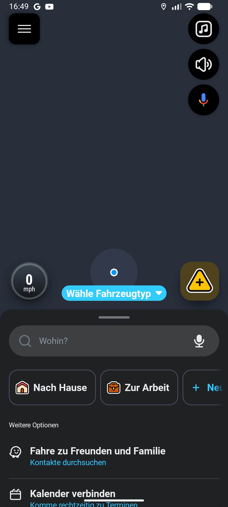
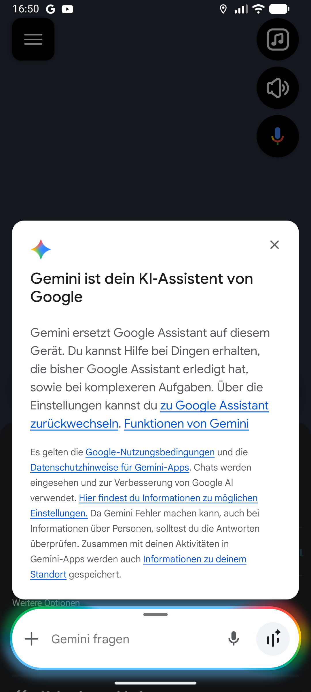
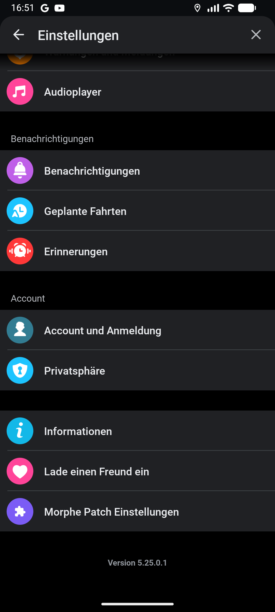
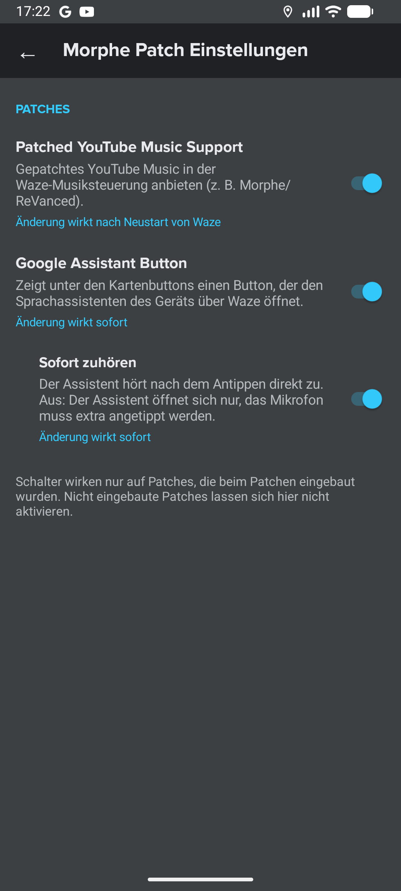

# 🧩 Morphe Waze Patches

Morphe patches for [Waze](https://play.google.com/store/apps/details?id=com.waze).

## ❓ About

| Patch | What it does |
|---|---|
| **Waze – Patched YouTube Music Support** | Lets Waze use a YouTube Music app patched with Morphe (`app.morphe.android.apps.youtube.music`) in its built-in music player. Without it, Waze reports YouTube Music as "not installed". |
| **Morphe Patch Settings** | Adds **Morphe Patch Einstellungen** (*Morphe patch settings*) at the bottom of the Waze settings, with a switch for each Morphe patch. |
| **Always Play Speed Camera Sound** | Waze shows speed camera alerts on screen, but plays the alert sound only when you drive above the speed limit. This patch plays the sound for every speed camera. |
| **Google Assistant Button** | Adds a button below the audio and sound buttons of the map. It opens the voice assistant of the device (Google Assistant or Gemini) on top of Waze, so the map stays visible. |

Only Waze is patched. YouTube Music and the assistant app are not changed.

## 🚀 Add these patches to Morphe

### 👉 [Click here to add these patches to Morphe](https://morphe.software/add-source?github=Pilotkosinus/morphe-waze-patches)

Or add the source manually in Morphe Manager: `https://github.com/Pilotkosinus/morphe-waze-patches`

Then select Waze in Morphe Manager, apply the patches and install the patched Waze.

> [!IMPORTANT]
> * The patched Waze is signed with a different key, so the Play Store version must be uninstalled first.
> * **"Sign in with Google" does not work in a re-signed Waze.** Google binds the Waze OAuth client
>   to the original signing certificate (`UNREGISTERED_ON_API_CONSOLE`). Sign in with your email address instead.
> * If you install the patched YouTube Music after Waze, restart Waze once so it detects it.

## 🩹 Patches list

<!-- PATCHES_START EXPANDED -->
> **[v1.4.0](https://github.com/Pilotkosinus/morphe-waze-patches/releases/tag/v1.4.0)**&nbsp;&nbsp;•&nbsp;&nbsp;`main`&nbsp;&nbsp;•&nbsp;&nbsp;4 patches total
<details open>
<summary>📦 Waze&nbsp;&nbsp;•&nbsp;&nbsp;4 patches</summary>
<br>

**🎯 Supported versions:**

| 5.25.0.1 |
| :---: |

| 💊&nbsp;Patch | 📜&nbsp;Description | ⚙️&nbsp;Options |
|----------|----------------|-----------|
| [Always Play Speed Camera Sound](#always-play-speed-camera-sound) | Waze shows speed camera alerts on screen, but plays the alert sound only when you drive above the speed limit. This patch plays the sound for every speed camera. Can be turned off in the Morphe patch settings. |  |
| [Google Assistant Button](#google-assistant-button) | Adds a button below the audio and sound buttons of the map. It opens the voice assistant of the device on top of Waze, so the map stays visible. |  |
| [Morphe Patch Settings](#morphe-patch-settings) | Adds "Morphe Patch Einstellungen" at the bottom of the Waze settings. It shows all applied Morphe patches with a switch to turn each of them on or off. |  |
| [Waze – Patched YouTube Music Support](#waze-patched-youtube-music-support) | Adds a repackaged YouTube Music app (for example patched with Morphe) to the audio partners of Waze, so it can be selected and controlled from the Waze music player. The original YouTube Music app keeps working. | • Package names |

</details>

<!-- PATCHES_END -->

## 📸 Screenshots

| Assistant button on the map | Assistant on top of Waze | Settings entry | Morphe patch settings |
|:---:|:---:|:---:|:---:|
|  |  |  |  |

## ⚙️ Turning features on and off

Open **Waze → Settings → Morphe Patch Einstellungen** (at the bottom, above the version number).

| Switch | When the change applies |
|---|---|
| Patched YouTube Music Support | After restarting Waze. The page shows a **Restart** button. |
| Google Assistant Button | Immediately. The button appears or disappears on the map. |
| Always play speed camera sound (*Blitzer-Warnton immer abspielen*) | Immediately. Off restores the original Waze value. |
| ↳ Listen immediately (*Sofort zuhören*) | Immediately. On: the assistant starts listening right after tapping the button. Off: the assistant only opens, tap its microphone to speak. Only available while the button is on. |

* The page is shown in German if the device (or Waze) language is German, and in English for every other language.
* At the bottom, the page shows the author and a GitHub icon that opens this repository.
* The settings are saved in Waze (`shared_prefs/morphe_patch_settings.xml`) and are kept after a restart.
* All features are on by default.
* Only patches that were applied in Morphe Manager can be switched. A patch that was not
  applied is shown as "not included" and cannot be turned on, because its code is not in the APK.
* Each patch also works without the settings patch. It is then always on.

## 🎙️ Google Assistant Button

The button opens the assistant that is selected as *digital assistant app* in the Android settings,
using the official Android interfaces. The assistant shows its own overlay on top of Waze, and Waze stays
the navigation app below it.

| Listen immediately | Interface | Behavior (tested with Gemini in the Google app) |
|---|---|---|
| On (default) | [`Intent.ACTION_VOICE_COMMAND`](https://developer.android.com/reference/android/content/Intent#ACTION_VOICE_COMMAND) | Overlay opens and the microphone is recording right away |
| Off | [`Activity.showAssist()`](https://developer.android.com/reference/android/app/Activity#showAssist(android.os.Bundle)) | Overlay opens like long-pressing home, tap the microphone to speak |

The other interface is used as fallback if the first one is not available.

* The look of the assistant overlay is controlled by the assistant app (Google Assistant or Gemini), not by Waze.
  Waze cannot make it more transparent.
* If no assistant is available at all, a message explains how to select one.
* The button slides out and in together with the audio and sound buttons, for example while the map is moved or zoomed.
* There is no separate speech recognition. All voice commands are handled by the real assistant.
* The button has the same size (56dp), shadow, colors (day and night) and spacing as the Waze map buttons.

## 🔍 How it works

### Waze – Patched YouTube Music Support

Waze 5.25.0.1, class `com.waze.sdk.SdkConfiguration`:

1. `updateAppList()` loads the audio partner allowlist from the Waze server
   (`NativeManager.configGetSdkConfigurationNTV()`), keyed by package name. It contains
   `com.google.android.apps.youtube.music` (scope `0x200007`), but not repackaged builds.
2. When the music app binds to `com.waze.sdk.SdkService`, Waze identifies the caller with
   `PackageManager.getNameForUid(Binder.getCallingUid())` and rejects packages that are not on the list.

Waze does not check the partner app's signature, and YouTube Music does not check Waze's signature.
The `com.waze.sdk.audio.ACTION_INIT` intent is already declared in Waze's `<queries>`.

| Method | Change |
|---|---|
| `SdkConfiguration.updateAppList()` | After the server list is loaded, adds every installed repackaged YouTube Music with the name and scope of the original YouTube Music entry. |
| `SdkConfiguration.getCustomizedAppIconUrl(Resources, String)` | Maps the patched package name to the original one, because the server only hosts the original icon. |

Patched YouTube Music apps are detected by their `MusicWazeBroadcastReceiver`, whatever the package name.
The `packageNames` patch option can add more package names (default `app.morphe.android.apps.youtube.music`).

### Morphe Patch Settings

The Waze settings are a tree of obfuscated node classes that is built in code.

| Location | Change |
|---|---|
| Settings page constructor (found from the `SETTINGS_MAIN_SETTINGS` page) | For the page `settings_main`, the extension adds a button node before the version text. The button class and its click listener interface are taken from the `ABOUT_SETTINGS` entry at patch time. |
| `AndroidManifest.xml` | Declares the settings activity of the extension. |
| Resources | Adds the title (`morphe_settings_title`, English and German) and the icon. |

The settings page reads the Waze day/night mode from `AppCompatDelegate` (found by its log message).

### Always Play Speed Camera Sound

The native alerting code of Waze (`libwaze.so`) reads the configuration value
`Play Speed Camera Sound Below Speed Limit`
(`ConfigValues.CONFIG_VALUE_ALERTS_PLAY_SPEED_CAMERA_SOUND_BELOW_SPEED_LIMIT`, default `false`).
While it is `false`, the speed camera alert is shown on screen, but the sound only plays above the speed limit.

The extension sets the value to `true` with `ConfigManager.setConfigValueBool()`, which writes to the native
configuration. It is applied on app start (`NativeManager.flushOnAppStartedEvents()`) and again after every
configuration sync with the Waze server (`ConfigManager.onConfigSyncedFromServer()`/`onConfigSyncedToServer()`),
because the server can change configuration values. When the feature is turned off, the original value is restored.
All names used are not obfuscated.

### Google Assistant Button

The map buttons are a Jetpack Compose column (`ButtonPackPortrait`) or row (`ButtonPackLandscape`).
The patch calls the extension right before the column/row is closed, and the extension adds the button with
Compose's `AndroidView`. Waze hides its buttons by sliding them off screen with an offset that it passes to
every `ButtonPackButton(button, onClick, offsetX, offsetY, ...)` call. The patch passes the same offset to the
extension, which moves the assistant button with them. The methods are found by their Compose trace strings
(`com.waze.main_screen.button_pack.ButtonPackPortrait (`), which are not obfuscated.

## 🧪 Testing status

Tested with Waze 5.25.0.1 on an Android 16 emulator (Google Play image, assistant: Gemini in the Google app).
Waze cannot sign in on the emulator (Play Integrity), not even unpatched, so the map was opened with the
deep link `waze://?a=settings`.

| Test | Result |
|---|---|
| Patched YouTube Music added to the Waze partner list, SDK handshake and `MusicBrowserService` connection | ✅ |
| Patched YouTube Music shown as audio app on the map | ✅ real device (user report) |
| Settings entry at the bottom of the Waze settings, page opens, day/night colors | ✅ |
| Switches, saved after restart, restart button, YouTube Music support off after restart | ✅ |
| Assistant button below the sound button with the same size, color and spacing | ✅ |
| Assistant button hides/shows immediately when switched | ✅ |
| Button opens the assistant as overlay on top of Waze | ✅ |
| Listen immediately on: assistant records right away (`ACTION_VOICE_COMMAND`); off: no recording (`showAssist`) | ✅ |
| Option is disabled while the assistant button is off | ✅ |
| Button slides out with the other buttons when the map is moved and back in after re-centering; no tap while hidden | ✅ |
| Speed camera sound: native value changed from `false` to `true`, kept after restart, restored when turned off | ✅ |
| Speed camera sound actually played below the speed limit while driving | ⚠️ not tested (needs a signed-in Waze and a drive) |
| Assistant button during active navigation | ⚠️ not tested (needs a signed-in Waze) |
| Landscape layout | ⚠️ not tested |
| Play/pause/skip of YouTube Music from Waze | ⚠️ not tested |

## ✅ Compatibility

* Waze **5.25.0.1** (tested). Other versions are marked as experimental. The fingerprints use strings and
  names that are not obfuscated, so newer versions should usually work.
* Android 12 or newer (minimum of Waze).

## 🧑‍💻 Development

```sh
./gradlew buildAndroid
# patches/build/libs/patches-*.mpp
```

Apply the `.mpp` with [Morphe Desktop](https://github.com/MorpheApp/morphe-desktop), for example:

```sh
java -jar morphe-desktop-all.jar patch --patches=patches/build/libs/patches-1.0.0.mpp waze.apks
adb uninstall com.waze
adb install waze-patched.apk
```

`waze.apks` is a zip of the Waze split APKs (`adb shell pm path com.waze`).

Building needs a GitHub token for the Morphe Gradle plugin on GitHub Packages
(`gpr.user`/`gpr.key` in `~/.gradle/gradle.properties`, or `GITHUB_ACTOR`/`GITHUB_TOKEN`).

### Project structure

```text
patches/src/main/kotlin/app/wazeytm/patches/
├── shared/                Compatibility, patch registry helpers
└── waze/
    ├── music/             Waze – Patched YouTube Music Support
    ├── settings/          Morphe Patch Settings
    ├── assistant/         Google Assistant Button
    └── alerts/            Always Play Speed Camera Sound
extensions/waze/src/main/java/app/wazeytm/extension/waze/
├── PatchedYouTubeMusicSupportPatch.java
├── settings/              MorpheSettings (central config), PatchRegistry, settings page, menu hook
├── assistant/             Compose hook, button view, assistant launcher
└── alerts/                Speed camera sound configuration
```

### Adding a new patch to the settings

1. Add a method returning `false` to `PatchRegistry` and call `markPatchIncluded("<method>")` in the patch.
2. Add an entry to `MorpheSettings.Feature` with title, description and `requiresRestart`.
3. Check `MorpheSettings.isEnabled(Feature.X)` in the extension code of the patch.

### Updating for a new Waze version

1. Decompile Waze with jadx.
2. YouTube Music: `SdkConfiguration.updateAppList()` still calls `configGetSdkConfigurationNTV()` followed by
   `move-result-object`, and `getCustomizedAppIconUrl(Resources, String)` still exists.
3. Settings: the main settings still use the strings `ABOUT_SETTINGS` and `SETTINGS_MAIN_SETTINGS`.
4. Assistant: the trace strings `com.waze.main_screen.button_pack.ButtonPackPortrait (` and
   `...ButtonPackLandscape (` still exist and the methods call `Composer.endNode()`.
5. Add the version as `AppTarget` in `Constants.kt`.

Releases are created by [release.yml](.github/workflows/release.yml) for `feat:`/`fix:` commits on `main` (stable) and `dev` (pre-release).

## 📜 License

These patches are licensed under the [GNU General Public License v3.0](LICENSE).
